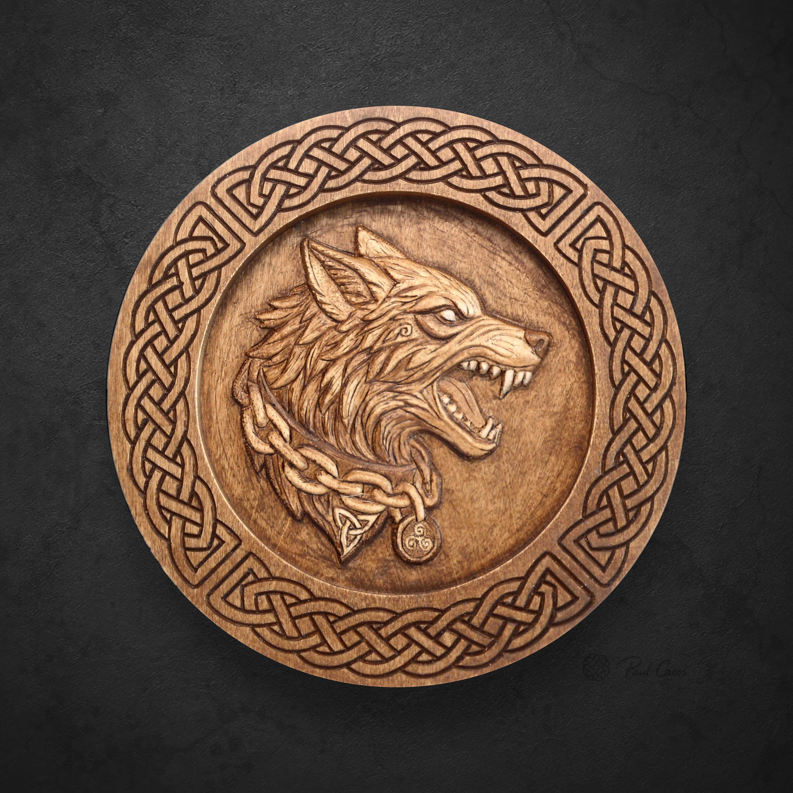

There is a place where the path ends and the forest begins. For those who live among walls, fences and boundaries, it is the edge of the known world. Beyond it lies a landscape that follows different laws: a place of hunger and abundance, birth and death, silence and pursuit. The wolf belongs to that boundary. It resembles the animal that came to share our fires, yet it remains beyond their light. It knows the paths of the forest but owes them to no one. It can move close to the human world without becoming part of it. The surviving stories do not give us a simple ancient doctrine in which the wolf means only courage, loyalty or protection. They offer something more interesting. Again and again the wolf appears where boundaries become uncertain: between wilderness and settlement, animal and human, hunter and hunted, danger and protection. The wolf is therefore not the image of a single quality. It is the image of a threshold. A note on sources. When we speak here of a “Celtic” wolf tradition, we rely above all on Irish sources. Most of them were written down by Christian scribes in the Middle Ages, preserving older material that had passed through many hands. This is not a single system of belief but a mosaic of stories, names, language and folklore. Yet from that mosaic a remarkably consistent picture emerges.

## The Wolf in a Real Landscape

Before the wolf becomes a symbol, we must remember that it was first of all an animal: a large predator that shared forests, mountain slopes and the edges of pastures with people. It hunted, scavenged and competed for prey. It could inspire fear precisely because its strength was real. In Ireland it remained a reality for a remarkably long time. The last wild wolf in Ireland is said to have been killed near Mount Leinster in 1786, roughly three centuries after wolves vanished from England and about a century after they disappeared from Scotland. The annals record wolves attacking people, for example under the years 1137 and 1420, and in the seventeenth century Ireland is reported to have been nicknamed “wolf-land”. Deforestation, bounties and organised hunting brought the wolf down, and Cromwell’s government paid rewards for wolves and banned the export of Irish wolfhounds (see Hickey’s study of the wolf’s extermination ). The stories about the wolf were not told far from the animal. They were told in a country where people genuinely feared for their sheep and children. The old tales preserve something of that unease. In The Destruction of Da Derga’s Hostel , the wounded warrior Mac Cácht lies on the battlefield and feels something nipping at his wound. He takes it for a fly, a gnat or an ant. It turns out to be a hairy wolf, buried in the wound up to its shoulders. A woman drags it out by the tail and Mac Cácht kills it with a single blow to the forehead. There is nothing gentle or romantic about the scene. The wolf belongs to a world in which survival has teeth. The modern Druid writer John Michael Greer makes a useful observation: the natural world should not be romanticised. Animals live within cycles of struggle, predation and death as surely as they live within cycles of birth and renewal. This matters. A symbol loses depth when we remove everything from it that can disturb us. The wolf is not powerful because it is harmless. It is powerful because its calm contains the possibility of attack. I don’t need to attack for you to know that I can.

## Son of the Land, Wild Hound

Irish preserves several names for the wolf, and each says something different. One of the most evocative is *mac tíre*, literally “son of the land” or “son of the country”. It is attested in early literature and still lives in modern dialects, especially in Ulster (Hughes, 2012). There is also *cú allaidh*, “wild hound”, and the older Irish *fáel*, represented by modern Irish *faol*. *Faol* also survives in personal names such as Faolán, “little wolf”. In Welsh the wolf is *blaidd*, and its trace can be heard in the name Bleddyn. The wolf is written on the map of Ireland, too. Toom, just east of Enniscorthy in County Wexford, was *Tuaim na Mac Tíre*, “the mound of the wolves”, and many more such names survive across Ireland (as recorded in Logainm, the Placenames Database of Ireland). The wolf is thus not merely an animal living in the land; it is the land’s son. It does not pass through the landscape as a visitor, but belongs to it intimately. Language tells us something subtle: the wolf lived close enough to human imagination to become part of the speech through which people named landscape, animals, and eventually one another. Notice how often wolf and hound overlap. The greatest of the Irish heroes is called Cú Chulainn, “the Hound of Culann”, and one of the names for the wolf is itself a kind of hound, *cú allaidh*. The line between dog and wolf is permeable in these stories, like so many others. 

## The Hunter, the Fían and the Hound on the Border

The wolf naturally belongs to the world of the hunt. The tales of Fionn mac Cumhaill and the Fíanna repeatedly lead away from settlements into forests, mountains, and hunting grounds. The *fían* was a real social institution: a band of free-born young men who, in the definition associated with Kim McCone’s work, had left fosterage but had not yet inherited the land needed to settle down as full members of the *túath*. For much of the year they lived in the wild, hunting and raiding. Irish literature often gives warriors canine or wolfish traits, from ferocity and unpredictability to a wild appearance, and scholars have compared the *fían* with the young warrior-bands of other Indo-European societies. To this world belong Fionn’s famous companions Bran and Sceolang. They are usually understood as extraordinary hunting hounds, standing between wolf and dog: companions of humans that still carry the strength of the forest, of scent, pursuit, and blood.

## The King Who Kept Wolves as Hostages

The most remarkable wolf scene in Irish literature is not a scene of combat, but one of agreement. *The Destruction of Da Derga’s Hostel* describes the golden age of King Conaire’s reign. Under him, wolves attacked only one bull-calf from each cowshed, and to keep that rule the king held seven wolves as hostages by the side wall of his house. The wild receives its share, one calf from each byre, and in return respects the boundary. The just king is the one who knows how to make peace with the forest. The story has a darker side: Conaire’s foster-brothers lead a band of young nobles who were “were-wolfing” in Connacht. When they are caught, the king spares them death and sends them into exile, which eventually leads to his downfall. The wolf within the treaty protects the peace; the wolf outside it breaks it.

## The Morrígan as a She-Wolf

One of the clearest appearances of the wolf in medieval Irish literature is in the *Táin Bó Cúailnge*. In Lucy Faraday’s translation, Cú Chulainn is fighting at the fords, and the Morrígan threatens to interfere in his combats: first as an eel, then as a grey she-wolf driving cattle onto the ford, and finally as a hornless red heifer. Cú Chulainn wounds her in every form and wins the fight. The she-wolf here represents disruption: driven cattle, muddied water, and lost footing. In the *Táin Bó Regamna*, she tells him that she will guard his death. That, too, is a face of a guardian: the one who stands at the boundary between life and death. The old stories rarely behave neatly: their animals can protect and destroy, reminding us that the wild is neither evil nor obliged to be safe.

## The Wolf Mother: A King Raised in a Cave

Irish tradition also knows a wolf that raises a child. The birth-tales of Cormac mac Airt, the legendary High King of Ireland, say that as an infant he was carried off by a she-wolf and reared in a cave among cubs. These traditions, found in *Scéla Éogain ocus Cormaic* and *Genemuin Chormaic* (edited by Tomás Ó Cathasaigh), are early medieval. Sligo folklore recorded in the Schools’ Collection adds vivid local detail, locating the tale at the Caves of Kesh. Cormac eventually emerges from the cave to unite the country from Tara. A ruler who wants to hold a boundary justly must know both sides of it.

## When the Human Becomes the Wolf

In medieval Irish tradition there is an even stranger boundary: the boundary between wolf and human. Stories connected with Ossory preserve traditions of people who take the form of wolves, famously recounted by Gerald of Wales in the late twelfth century. A priest travelling from Ulster into Meath meets a talking wolf from Ossory, who asks for the last rites for his dying wife. The *Annals of the Four Masters*, under the year 690, likewise record that in Leinster a wolf was heard speaking with a human voice. The wilderness is not only a place beyond the settlement; something of it can live within us.

## Predator and Protector: Wolves and Saints

Irish tradition also allows the relationship to reverse. In the *Life of Saint Abbán*, a wolf appears to the saint as a boy, receiving a calf and later becoming a guardian of the flock. Wolves act as herders in the Lives of Saint Fintan and Saint Brigit, and Saint Ailbe of Emly was according to legend nursed by a she-wolf as an infant. Danger and guardianship are twin aspects of the same power: the creature that can cross the boundary is also capable of guarding it.

## What Did the Wolf Mean to the Celts?

The temptation is to give a simple answer: strength, loyalty, intuition, courage, protection. Such lists are common in modern writing about Celtic symbolism. The surviving evidence does not justify reducing the wolf to them. We have fragments of mythology, medieval literature written down in societies that had already changed profoundly, archaeology, place names, language, folklore and later Romantic and neo-Druid interpretations. We do not possess an ancient Druid handbook telling us that the wolf represented five particular qualities. A historical source can show us where and how the wolf appeared. It does not automatically follow that every modern meaning was part of the original belief. It helps to separate two questions. The first: What can we document about the wolf in historical and literary sources? The second: What can the wolf mean to a person today? The first is answered by texts, language and the history of the land. The second belongs to personal experience, modern Druid practice and creative work with symbols. The two can meet, as long as we do not confuse them. Modern Druidry itself offers a useful warning. Greer openly distinguishes historical material from symbolism developed by the Druid Revival and modern practitioners. Even within his treatment of Ogham, he identifies which associations come from older Irish texts and which animal, calendrical, elemental and divinatory correspondences are later additions. This does not make modern symbolism meaningless. It makes its origin clear. A living tradition does not have to pretend that every new branch is an ancient root. Greer describes Druidry itself as something that continues to grow and change, and warns against treating any single modern book as infallible. For him, the ultimate teacher is nature. So perhaps the second question is best asked not as What did the wolf mean? but as What can the wolf teach us?

## The Guardian at the Boundary

This is where historical tradition ends and my own interpretation begins. In my work, the wolf becomes a guardian. Not because I have found an ancient text declaring the wolf a Celtic symbol of protection. I have found no surviving ancient text that says so. But I have found something else that gives the interpretation ground to stand on. A wolf that becomes the shepherd of a flock. Wolves that sit as hostages by a king’s wall, their presence holding the peace. A she-wolf who raises a future king. These stories are not a doctrine of protection, but together they form a pattern. The meaning comes from the place the wolf occupies. At the boundary. Between the path and the forest. Between the fire and the darkness beyond it. Between what has accepted human order and what remains wild. Between animal and human in stories where one can become the other. A guardian must understand both sides of the threshold. It cannot belong only to the world of order. To guard the edge of the forest it must know the forest. And it must possess something more than kindness. It must be capable of saying no. The wolf does not need to attack everything that approaches. It watches. It listens. It knows its territory. It conserves its strength. But the possibility of that strength is always present. Without that possibility, there is no protection.

## The Wild Within

A boundary need not be only a fence, a gate or the edge of a forest. It can be inner: between rest and exhaustion, between helping others and denying oneself, between openness and exposure to what we can no longer bear. In this the wolf is a reminder that a boundary is not hostility. To protect your space does not mean hating the world beyond it. It means recognising what belongs inside and what does not. The wolf does not say: Everything beyond the boundary is an enemy. It says: Notice what is approaching. Its wildness need not mean chaos. It can stand for the part of a person that responds before everything has been explained by reason: it notices a change in a voice, in a movement, in the atmosphere of a room, and picks up a tension that does not yet have a name. To work with the wolf can therefore be a return to instinct, to the body and to the land. We learn to listen to our own boundaries, to tell real danger from needless fear, and to accept the part of ourselves that cannot be entirely tamed.

## Wolf Guardian: Wood at the Threshold

The Wolf Guardian roundels grew from this interpretation. They are not reproductions of an archaeological original, nor a claim that historical Druids used precisely this image. This is contemporary work, drawing on older stories, experience of nature and personal symbolism. Each is made as an individual work rather than as a reproduction of an identical design. The wolf remains recognisable, but the wood, the grain, the surface, the details and the character of every piece are allowed to become their own. One may look calm and still; another may carry tension in its eyes and ears tuned to a sound from the forest. Wood is a natural material for such a symbol. It comes from a tree that itself stood between worlds: between roots below the earth, a trunk in the human realm and a crown exposed to wind and light. When it becomes a guardian, it need not lose its memory. It can reveal it. Each guardian therefore belongs to a particular threshold: a doorway, a garden, a place of quiet, the beginning of a new stage of life. And, eventually, to a particular keeper. I believe that when a work is created with a clean intention, a connection already begins to exist between it and the person who will one day keep it. The meeting simply has not happened yet.

## Conclusion: The Guardian at Your Boundary

The wolf is one of those beings that cannot be fully domesticated. In Irish tradition we find it as a real predator, a son of the land, a companion of the hunter, the shape of a goddess, an image of transformation, a cursed human, a hostage under treaty and a shepherd of the flock. Its meaning cannot be closed into a single word, and that is exactly why it stays alive. This is the wolf I carve. Not an emblem of aggression, and not a domesticated image of loyalty. A presence at the boundary. Watchful. Wild. Still. Somewhere between the known path and the wild country beyond it, two paths eventually cross. The path of the wood, and the path of the person who will keep it. And the guardian takes its place. May the wolf at your boundary know what should be welcomed, what should pass, and what must go no further.

## Sources and Further Reading

### Primary texts

- Togail Bruidne Dá Derga (The Destruction of Da Derga’s Hostel), trans. Whitley Stokes. CELT, University College Cork. [https://celt.ucc.ie/document/T301017A](https://celt.ucc.ie/document/T301017A)

- Táin Bú Cúailnge, the Morrígan’s conversation with Cú Chulainn, trans. Lucy Winifred Faraday. Cartlann. [https://cartlann.org/the-conversation-of-the-morrigan-with-cu-chulainn/](https://cartlann.org/the-conversation-of-the-morrigan-with-cu-chulainn/)

- Scíla óigfhir ocus Cormaic and Genemuin Chormaic, ed. Tomás Ó Cathasaigh, *The Heroic Biography of Cormac mac Airt* (Dublin, 1977).

- Life of Saint Abbán , in Charles Plummer, Bethada Náem nórenn (Lives of Irish Saints), 1922. CELT. [https://celt.ucc.ie/document/T201000G/](https://celt.ucc.ie/document/T201000G/)

- Vita sancti Albei (Ailbe of Emly), in Charles Plummer, Vitae Sanctorum Hiberniae (Oxford, 1910); cf. W. W. Heist, Vitae Sanctorum Hiberniae ex codice olim Salmanticensi (Brussels, 1965).

- Annals of the Four Masters (entry for 690). CELT. [https://celt.ucc.ie/published/T100005A/text052.html](https://celt.ucc.ie/published/T100005A/text052.html)

- Gerald of Wales, Topographia Hibernica (the priest and the werewolves of Ossory). [http://www.luminarium.org/mythology/ireland/werewolves.htm](http://www.luminarium.org/mythology/ireland/werewolves.htm)

### Studies and background

- Kieran Hickey, “A Geographical Perspective on the Decline and Extermination of the Irish Wolf” (archived). [https://web.archive.org/web/20120907043329/http://www.ucd.ie/gsi/pdf/33-2/lupus.pdf](https://web.archive.org/web/20120907043329/http://www.ucd.ie/gsi/pdf/33-2/lupus.pdf)

- A. J. Hughes, “On substantiating Indo-European ‘wolf’ in Celtic, Continental and Insular”, *Études Celtiques* 38 (2012): 165–173. https://codecs.vanhamel.nl/Hughes_(A.J.)_2012_38agig

- Logainm, the Placenames Database of Ireland (wolf in Irish place names). [https://www.logainm.ie/en/themes/99](https://www.logainm.ie/en/themes/99)

- Kim McCone (2024), on the heroic biography of Cormac mac Airt. [https://kimmccone.org/ZcP71McCone2024HeroicBiogOffprint-1.pdf](https://kimmccone.org/ZcP71McCone2024HeroicBiogOffprint-1.pdf) ; and Pagan Past and Christian Present in Early Irish Literature (Maynooth, 1990), on the fían.

- National Folklore Collection, Schools’ Collection: Cormac mac Airt reared by wolves (Co. Sligo). [https://www.duchas.ie/en/cbes/4672097/4670256](https://www.duchas.ie/en/cbes/4672097/4670256)

- “Wolf”, in Animaliter (University of Mainz): narrative texts on wolves in hagiography. [https://www.animaliter.uni-mainz.de/?p=2477](https://www.animaliter.uni-mainz.de/?p=2477)

- John Carey, Werewolves in Medieval Ireland , Cambridge Medieval Celtic Studies, 1981.

- John Michael Greer, The Druidry Handbook .
